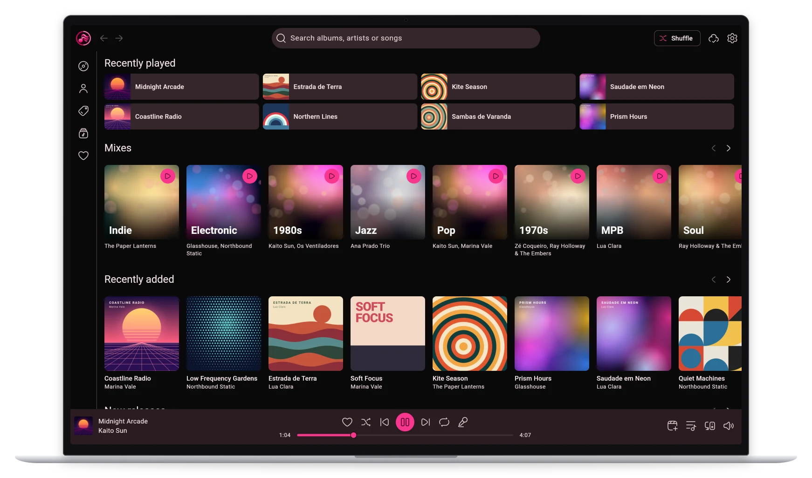
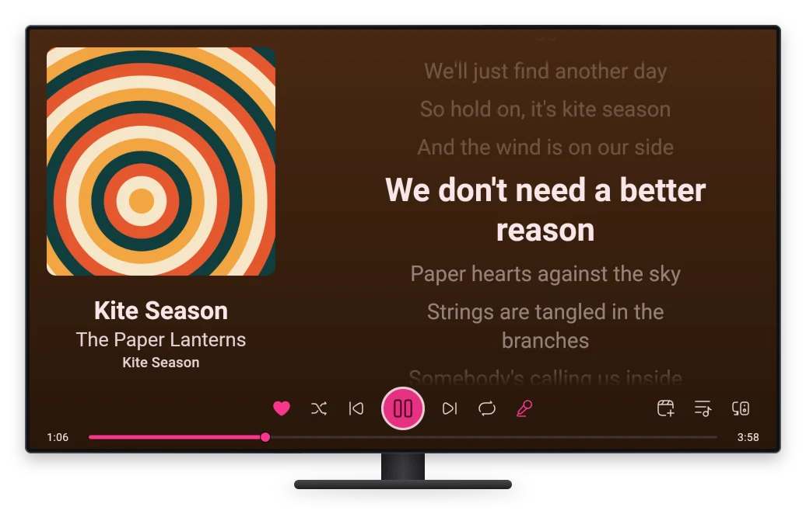
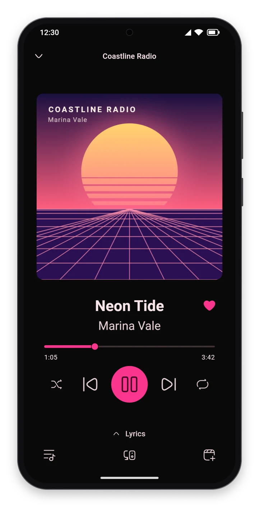
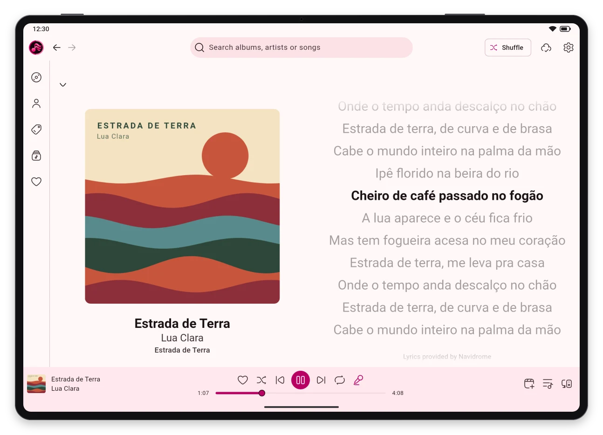

<p align="center"></p>

# Segue app

A music player for Navidrome, any other OpenSubsonic server, or Jellyfin, built around Segue Connect: you pick a
device, and whatever you play goes there. One Flutter codebase for Linux, Windows, macOS, Android and iOS, in
Portuguese, English and Spanish.

Segue's protocol and its hub, which runs next to the media server, are in
[segue-music/segue](https://github.com/segue-music/segue). Without a hub, the app plays on the device it runs on.

<p align="center">
  <a href="docs/screenshots/desktop.png"></a>
  <a href="docs/screenshots/tv.png"></a>
</p>
<p align="center">
  <a href="docs/screenshots/phone.png"></a>
  <a href="docs/screenshots/tablet.png"></a>
</p>

> [!NOTE]
> **Vibe-coded.** The app was written by Claude (through Claude Code), with a person deciding what
> to build and trying it on real devices. Every commit says so.

**Status: not released.** The Android APK is in no store, the Linux and Windows builds are only a tarball and a zip, all
three in this repository's releases ("Releases"), and the iOS one reaches only TestFlight's internal group. The
Android build has been tried on a tablet and on an Android TV, the iOS build on an iPhone, with CarPlay's Now Playing
screen, and the Windows build on Windows 11. macOS has no package yet.

## Features

### Signing in

- Only the media server's address, user and password (`https://` is added if left out). The app finds out whether
  the server speaks Subsonic (Navidrome, other OpenSubsonic servers) or Jellyfin: a Jellyfin server, or Navidrome's
  Jellyfin API at `/jellyfin`, experimental since Navidrome 0.64 and turned on with `ND_JELLYFIN_ENABLED=true`.
- The password isn't kept: the system's secure storage gets a Subsonic token, or Jellyfin's access token. Signing
  out, at the end of the settings, ends a Jellyfin server's token; Navidrome's lasts until the password changes.

### Library

- **Home**, where the app opens: a row of mixes, then rows of the latest released albums, the most played and the
  latest added. A row's title opens the albums tab in that order. Dragging the home down from its top loads it again.
  As the app opens, the home shows at once what it showed the time before, covers too, kept on the device, while it
  loads again; its mixes are those picked the time before. On a phone, its top bar has two chips: "Aleatório", which
  plays the whole library at random, and "Favoritas", which opens the favorite songs.
- **Mixes**: 100 songs of the library at random, of a genre ("Rock") or of a decade ("Anos 70"), from the genres and
  decades the user plays most (before anything has played, the genres with the most albums). They are picked again
  each time the home loads, the more played the likelier. A mix plays the first songs its tile shows, and autoplay
  goes on after its last. Out of the server's reach, there are no mixes.
- **Albums**: by name, latest released, most played or latest added. Wherever albums are listed, the album's artist
  opens their page, and on a computer or a tablet a button on the cover plays the album.
- **Artists**: by name or most played.
- **Genres**: by name, under the ten the user listens to most. A genre's page has a button that plays its mix, a
  row of its most played albums, and its albums by name.
- **Playlists**: the user's and those shared with them, each with its picture and how many songs it has. A
  playlist's page is laid out as an album's.
- **Search**: artists, albums and songs.
- On a Subsonic server, which counts no plays by artist or genre, those come from the most played albums. On a
  Jellyfin server, which counts plays only by song, an album's, an artist's or a genre's plays are its songs', added
  up.

### Album and artist pages

- **Album**: its cover (which opens full screen), what kind of release it is (album, EP, single, compilation), its
  artist, year, songs and how long they last, and at the end its release date, its record labels and a row of the
  artist's other albums ("Mais de Aerosmith"). Where the server doesn't say the date, the labels or the kind,
  MusicBrainz fills them in: by the album's MusicBrainz id, or, for the date and the kind only, by its name, artist
  and year.
- **Credits**, from a button on the album's page: who performed it (with what they played or sang), wrote it and
  produced it, one a line, with the songs where it isn't all of them ("voz principal, gaita (faixa 2)"). The
  server's credits (OpenSubsonic's contributors, which Navidrome reads from the tags; Jellyfin's people), or, where
  it has none, MusicBrainz's. MusicBrainz also says where the album was recorded, mixed and mastered, and who made
  its cover and booklet, which the media servers never say.
- **Artist**: their picture, their genres, their albums (or, picked above them, their singles and EPs), five of their
  songs (the ones the user plays most, or the popular ones, which a Subsonic server learns from Last.fm) and a row of
  the library's artists like them. Where the server has no picture (Navidrome since 0.64), the one fanart.tv's users
  like most, by the artist's MusicBrainz id.
- **Biography**, from a button on the artist's page, where the server has one (Navidrome's comes from Last.fm): a
  gallery of pictures (the server's and up to three from fanart.tv), and from MusicBrainz a band's years together
  ("desde 1991") and members, and where the artist comes from ("Boston, Estados Unidos"), a link to a map (not on a
  TV).
- In the player, a song's title opens its album, and each of its artists their page. In an album's or a playlist's
  songs the artists link too, but not on a phone, where a finger on the song would often land on them.

### Playback

- **Player**: a bar that stays from page to page, and a full-screen player that the song in the bar opens. Seek,
  shuffle, repeat (the queue, or the track). On a phone, a swipe on the cover goes to the next or the previous song,
  and a drag down closes the player.
- **Volume**, on a computer, at the end of the bar: a button that mutes and gives the volume back, over which an
  upright slider opens as the pointer comes to it (or the keyboard's focus, whose up and down arrows move it). The
  mouse's wheel moves it over either. It is the volume of whichever device the app controls; this device's own the next
  launch keeps. A phone's and a TV's own buttons set the system's volume.
- **Lyrics**, beside the cover in the full-screen player (under it on a phone), and full screen: the server's
  (OpenSubsonic's songLyrics, as Navidrome's from the tags or a `.lrc`; Jellyfin's), or else LRCLIB's (lrclib.net).
  Synced ones mark the line that plays, and a line tapped goes there. Full screen, on a phone or a tablet, they keep
  the screen on. On a TV the full-screen player opens with them, as karaoke: in three fifths of the screen, the line
  that plays bigger, growing as it comes, in the middle, those to come faint and those gone by fainter, the screen on
  while they show. A song without lyrics shows the cover alone there, and they come back with one that has some.
- **Queue** of whichever device the app controls: a tap plays a track there, a drag moves it, and its menu takes it
  out (but the current one). Shuffled, a move changes the play order alone. A change the device refuses goes back,
  and a message says why.
- **Play next and add to queue**: a song, an album or a playlist, on whichever device the app controls. To an empty
  queue, they are the queue, paused at the first.
- The current song stands out in lists (an album's, a playlist's, search), with an equalizer in place of its number.
- A song the media server fails to give stops the player on it, paused, and says so, rather than the player skipping
  through the queue. Play tries it again.
- **Autoplay**: as the queue's last song starts, repeat off, songs like it go after it (on a Subsonic server,
  getSimilarSongs2; on Jellyfin, its instant mix). On until a switch turns it off, in the settings or after the
  queue's last song, which takes out the songs it added that haven't played.
- **Gapless**: each song right after the one before, as a live album plays. Not while crossfading.
- **Crossfade**, off until the settings pick 2 to 12 seconds: the next song gets louder as the one before gets
  quieter, at equal power.
- **Volume normalization** (ReplayGain): off, automatic (by album where a song plays among its album's in their
  order, by song otherwise), by song or by album. The gains are the server's (OpenSubsonic's replayGain; Jellyfin's
  normalization gain), or else the file's tags. The songs play 8 dB over ReplayGain's reference (about -10 LUFS), since
  at the reference most songs of today play 6 to 10 dB quieter than as they are, and never louder than their peak lets
  them.
- **Equalizer** of ten bands, from 31 Hz to 16 kHz: presets for kinds of music, or the user's own, each band 12 dB up
  or down. The whole goes down by as much as the bands raise, so that a song never clips.
- **Quality**: the files as they are; automatic, on a device with mobile data (as they are on Wi-Fi or a cable, 160
  kbps on mobile data); or 320, 160 or 96 kbps, transcoded by the server. A change holds from the next song. A song a
  Subsonic server transcodes seeks where the server has OpenSubsonic's transcodeOffset (Navidrome has it); Jellyfin
  sends it as HLS, which seeks.
- **Sleep timer**, while the music plays on this device: it pauses it after 5, 15, 30 or 45 minutes or an hour, or as
  the song ends, the music fading out over the last 30 seconds.
- **Plays** count toward the user's most played: on a Subsonic server once a song has played half or four minutes
  (not a song of 30 seconds or less), on a Jellyfin server by the hub.

Autoplay, the crossfade, the sleep timer, the normalization and the equalizer are each device's own: the protocol
knows nothing of them, and another device plays as it has them.

### Playlists and favorites

- **Playlists**: a new one from a button over the list of them; a song, an album or the song that plays added to one;
  on its page, a song taken out or moved by dragging it, and the playlist renamed or deleted. Another user's playlist,
  or a smart one, can only be played next or added to the queue.
- A song's menu is the button after its duration, the menu key or Shift+F10, a right click, or OK held on a TV's
  remote.
- **Favorites**: a heart on a song, an album or an artist (Subsonic's star, Jellyfin's favorite). The favorite songs
  come first among the playlists ("Músicas favoritas"), and the albums and artists tabs have a "Favoritos" chip. On a
  Subsonic server the latest come first; on Jellyfin, which doesn't say when, by name.
- Each change shows at once and goes to the server as it's made. One the server refuses goes back, and says so.

### Downloads and offline

- An album or a playlist downloads from the button beside its play button, which shows how far it has got, and
  pressed again takes it off the device, once asked. The songs come as their files are, or in the quality the
  settings pick for downloads, with their covers, lyrics and artists' pictures.
- On a device with mobile data, downloads go over Wi-Fi or a cable alone, unless the settings let them go over mobile
  data too. What failed comes again as the server is back, or from the button.
- The library's "Baixados" chip shows the downloaded albums, and the playlists' "Baixadas" chip the downloaded
  playlists. The settings list the downloads, with the room they take.
- With the server out of reach, the top bar says so and the app shows what was downloaded: the home, the library,
  search and their pages, which play from the files. The plays made meanwhile count as the server is back, at the
  time they were made.

### Connect

- The hub is found next to the server, or typed at sign-in, under "Avançado". The device picker lists the user's
  other devices that are online, with what they play, and picking one makes the app control it.
- Picking this device again moves the music here, at the same point, in the same modes. If the device it controls
  closes, its music stays here, paused. If its queue ends there, the player goes, and the app controls this device
  again, until another queue plays there.
- When another device starts playing, music left paused here goes, so that no device is listed paused with music that
  now plays elsewhere. An app opened when nothing plays anywhere picks up where the music was.

### Devices

- **Computer and tablet**: the top bar, the side rail (albums, artists, genres, playlists) and the player bar stay,
  and pages open between them. Arrows beside the app's icon, and the keyboard's left and right, go back and forward
  through them, as a browser's do. `/` goes to the search bar, and Esc takes the focus off what has it. On a
  computer the window opens maximized and gets no narrower than 960.
- **Phone**: the player bar and a bar with the home, the search and the library stay at the bottom, and a swipe goes
  from section to section. Pages open over the rest, and a swipe to the right from anywhere goes back.
- **Sign-in on a TV with a phone**: the TV's sign-in shows a QR code, which the app on a phone signed in reads
  (Settings, "Entrar numa TV"), signing the TV in with no typing on the remote. Over the local network, sealed with
  a key the code carries (AES-GCM): on Subsonic the phone's credentials; on Jellyfin the TV signs in by Quick Connect,
  which the phone authorizes, and gets a sign-in of its own (not on Navidrome's Jellyfin API, which has none). The
  phone sends it only to an address on the local network, after naming the TV and its address, which the TV shows
  under the code; the TV's answer is sealed too, and a code is good for one sign-in, the TV showing another after.
- **TV**: the remote drives the app, a white ring showing where it is, and an album, an artist or a mix it is on a
  little bigger. The text is a bit bigger than on a phone, and everything keeps out of the screen's edges, which some
  TVs cut off, but for the rows of albums, which run on to the side as they scroll, as Google TV's do. No player bar
  under the pages: the side rail's first button, while something plays, opens the full-screen player, as a video
  player: the controls showing as a key is pressed and going after a few seconds,
  back hiding them first. The screen stays on while the music plays. The keyboard opens on the search bar with the
  center button, OK held opens a menu, and a song of the queue or of a playlist moves by the remote ("Mover" in its
  menu, then the arrows and OK). The remote's play/pause, next and previous buttons drive playback.
- **The system's media controls** show and command what the player bar shows, the device it follows included: on
  Linux (MPRIS) the media keys, the desktop's player widget and KDE Connect; on iOS the lock screen, Control Center,
  the headphones' buttons and CarPlay's Now Playing; on Android the notification, the lock screen and the
  headphones' buttons, whose play opens the app if the system has closed it.
- **Android** plays in the background and with the screen off. Swiped out of the recent apps, the app closes as a
  window does on a computer: this device's music pauses, and another device's plays on. Playing pauses another app's
  music, and another app playing pauses this one.
- **Android Auto**: the home (mixes and albums), the playlists, the albums and the artists, search, and what is said
  ("Ok Google, toca Aerosmith no Segue"). What the car plays, it plays on the phone, and a device the app was
  controlling stops. Android's media controls offer the last song to resume.
- **iOS** plays in the background and with the silent switch on.
- On iOS and Android, a call pauses the music, which plays again after it, and leaving the car or unplugging the
  headphones pauses it.
- **Language**: the system's, where the app has it (English otherwise), until the settings, or before signing in a
  menu in the sign-in's corner, pick one.
- **Theme**: light, dark or the system's, in the icon's colors. The settings pick the pink, the wine or the neutral,
  and a high contrast for any of them (Material's text and outlines at 7:1 at least).
- **Licenses**: the settings list the open source licenses, those of libmpv, FFmpeg and Mbed TLS included where the
  app brings them (Android, iOS, macOS, Windows).

### Not yet

- Turning another device's autoplay on or off, or setting its sleep timer.
- The media controls on macOS and Windows.
- On a Jellyfin server: counting plays without the hub; the cover of a song that came from another device, when its
  file has none (Jellyfin doesn't fall back to the album's); and an artist's popular songs (Jellyfin knows only its
  users' plays).
- Sending the music to speakers and TVs that don't run the app (Google Cast, UPnP/DLNA).
- CarPlay as an app of its own, browsing the library on the car's screen, which needs Apple's CarPlay entitlement and
  native code.

## Running on Linux

`tool/package-linux.sh` builds the Linux version (see "Development") and packs it as `build/segue-linux-x64.tar.gz`.
The computer that runs it needs glibc 2.38 or newer, GTK 3, libsecret and libmpv, all runtime packages. On Fedora:

```sh
sudo dnf install gtk3 libsecret mpv-libs
tar xzf segue-linux-x64.tar.gz
segue/segue
```

`segue/install-desktop-entry.sh` puts Segue in the application menu, with its icon: it writes
`~/.local/share/applications/io.github.mateusguilherme.segue.desktop`, pointing at the folder (run it again after
moving the folder). On Wayland the window takes its icon from that file, so without it the window has a generic one.

## Running on Windows

`tool\package-windows.ps1`, in PowerShell, builds the Windows version (see "Flutter installed") and packs it as
`build\segue-windows-x64.zip`. The computer that runs it needs only 64-bit Windows 10 or 11: the zip carries Visual
C++'s runtime beside the app. Unzip it anywhere and open `segue\segue.exe`. The app isn't signed, so Windows may stop
it the first time when the zip came from the internet: "More info", then "Run anyway".

## Running on Android and Android TV

`tool/package-android.sh` builds `build/segue-android.apk` (see "Development"): one APK for every processor, to
install by hand with adb (`android-tools` on Fedora), signed with the app's key where this folder has it ("Releases"),
else with a debug key. An APK signed with another key than the installed app's doesn't install over it: the app has to
be uninstalled first, its sign-in and downloads with it. The device has to reach the media server (and the hub) at the
address used to sign in.

On a phone or a tablet, turn on wireless debugging (Settings > About: press "Build number" seven times, then
Developer options > Wireless debugging). Its main screen shows the address and port for `adb connect`; "Pair device
with pairing code" shows another port, and the code, for `adb pair`, once per computer:

```sh
adb pair <address>:<pairing port> <code>
adb connect <address>:<port>
adb install -r segue-android.apk
```

The port changes each time wireless debugging is turned on, and the address can change too when the device rejoins
the network. Over a slow Wi-Fi link, copying the APK to the device and opening it there does the same.

On an Android TV, turn on the developer options (Settings > Device Preferences > About: press "Build" seven times)
and, in them, network debugging; then `adb connect <TV address>` and `adb install`. Newer Google TVs offer wireless
debugging instead, paired as a phone is.

Android Auto lists an app installed by hand only from "unknown sources": in the Android Auto app's settings, tap
"Version" ten times for its developer settings, and there check "Unknown sources". To try it without a car, the
Desktop Head Unit shows the car's screen on a computer: in the Android SDK's manager, "Android Auto Desktop Head Unit
Emulator" (in `extras/google/auto/`), and on the phone, connected by USB, Android Auto's "Start head unit server" (in
its menu, with the developer settings on). Then:

```sh
adb forward tcp:5277 tcp:5277
<Android SDK>/extras/google/auto/desktop-head-unit
```

## Running on iOS

The iOS version needs a Mac to build, so it is built on Codemagic (`codemagic.yaml`), which signs it and uploads it
to App Store Connect; the iPhone installs it from TestFlight. That takes a paid Apple Developer Program membership.
Codemagic's free plan has enough build minutes for a few builds a week.

Once, on the web, with nothing to install:

1. In the Apple Developer site, under Certificates, Identifiers & Profiles, register the app's identifier: an
   explicit App ID `io.github.mateusguilherme.segue`, with no extra capabilities.
2. In App Store Connect, create the app with that bundle ID. Its name there has to be unique in the App Store; the
   home screen shows "Segue" whatever it is. In its TestFlight tab, make an internal testing group with yourself in it
   and automatic distribution on, so that each build reaches it.
3. In App Store Connect, under Users and Access > Integrations, make an App Store Connect API key with the App Manager
   role. Its `.p8` file downloads only once; note its Key ID and the Issuer ID.
4. In Codemagic, sign in with GitHub and add this repository. In the team's integrations, add the key under Developer
   Portal, named `segue` (the name `codemagic.yaml` asks for).
5. In Codemagic's code signing identities, generate an Apple Distribution certificate with that key. Then, in the
   Apple Developer site, make an App Store Connect provisioning profile for the App ID with that certificate, and
   fetch it in Codemagic.
6. In the app's environment variables in Codemagic, add `FANART_TV_KEY`, the fanart.tv key (see "Keys"), marked
   secret, in a group named `keys` (the name `codemagic.yaml` asks for: a build fails without that group, though the
   variable may be empty).

Then each build starts from Codemagic's page (workflow "iOS to TestFlight") or by pushing a tag starting with `ios-`:

```sh
git tag ios-1 && git push origin ios-1
```

It takes about 15 minutes, plus Apple's processing. The build then shows in the TestFlight app on the iPhone, from
the internal group's invitation, for 90 days. The first time the app reaches a server in the local network, iOS asks
for permission.

Codemagic may report the upload as failed when App Store Connect answers it with server errors (500), even though the
log says `UPLOAD SUCCEEDED`. The build often arrived anyway, so look in App Store Connect's TestFlight tab before
building again. Building the same commit again doesn't help either way: the build number counts the commits, and App
Store Connect refuses a number it already has.

What iOS does differently:
- In the background, iOS keeps the app running only while it plays. Paused, or just controlling another device, it is
  suspended after a while, and the hub sees it leave until it is opened again.
- In a car, the music shows in CarPlay's Now Playing screen, with its controls, but the app has no screen of its own
  there.
- Other devices see this one as "iPhone" (or "iPad"), not by its name in Settings (General > About > Name): since iOS
  16 an app reads that name only with an entitlement Apple grants on request
  (`com.apple.developer.device-information.user-assigned-device-name`), which the app doesn't have yet.

## Releases

`.github/workflows/release.yml` builds the Linux, Android and Windows packages on GitHub's machines, with the scripts
above, and for a tag `v<version>` puts them in a release of this repository, with their SHA-256 (`SHA256SUMS`). The
tag says pubspec.yaml's version, which the app shows in its settings: for a new one, change `version` there (the build
number after the `+` is the commit count's, whatever it says), commit, and

```sh
git tag v0.2.0 && git push origin v0.2.0
```

Run from the Actions tab ("Release", "Run workflow"), it only builds the packages, kept a day as the run's artifacts.
It takes the keys from the repository's secrets (Settings > Secrets and variables > Actions):

- `FANART_TV_KEY`: the fanart.tv key (see "Keys").
- `ANDROID_KEYSTORE`: the app's key, below, in base64 (`base64 -w0 android/release.jks`).
- `ANDROID_KEYSTORE_PASSWORD`: its password.

Android installs an update only when it is signed with the same key as the installed app, so the APKs handed out are
signed with the app's own, `android/release.jks`, not with a debug key, which is one computer's.
`android/key.properties` names it, and git ignores both:

```properties
storeFile=release.jks
storePassword=...
keyAlias=segue
keyPassword=...
```

Where they are, every build is signed with it, the debug one too, so that `flutter run` installs over a released APK
(with another key, it uninstalls the app first). Keep a copy of both away from this computer: with the key lost, no
update installs over the app, and whoever has it has to uninstall it first. It was made once, with a JDK's keytool
(the Android image has one), the password the same twice:

```sh
keytool -genkeypair -keystore android/release.jks -storetype PKCS12 -alias segue -keyalg RSA -keysize 4096 \
  -validity 10000 -dname CN=Segue
```

An APK signed with it has this certificate's SHA-256 (`apksigner verify --print-certs`, in the Android SDK's
build-tools): `b47c9a81410d037b1e3640579fad9acecc552f7d4d5bd7aab94fa1ebcaf8bb31`.

## Development

### Flutter from Docker

`tool/flutter.sh` runs Flutter from a Docker image, as your user, so nothing else needs installing:

```sh
docker build -t segue-flutter-dev -f tool/dev.Dockerfile tool
tool/flutter.sh pub get
tool/flutter.sh analyze
tool/flutter.sh test
tool/flutter.sh run -d linux
tool/package-linux.sh
```

`tool/flutter.sh run` opens the app in your desktop (Wayland or X11): the container gets the display, the GPU, the
sound and the session bus. Its settings are its own, in `~/.cache/segue-flutter`, but its token goes to the same
keyring as an installed copy's (the app id is the same), so signing out in one signs the other out too.

For Android, a second image adds the JDK and the Android SDK and NDK to the first:

```sh
docker build -t segue-flutter-android -f tool/android.Dockerfile tool
tool/package-android.sh
tool/flutter.sh run -d android
```

Once this image is built, `tool/flutter.sh run` takes it, and reaches the Android devices of your computer's adb
server (`adb devices`) as well as your desktop: a phone on USB, an emulator, or a TV after `adb connect`. `-d android`
stands for the first of them; with several, `-d` takes the one `adb devices` names. With none, `-d android` starts an
emulator: the Android SDK's (`ANDROID_HOME`, or `~/Android/Sdk`, where Android Studio puts it) on the first of its
virtual devices, or the one `SEGUE_AVD` names. It stays open after `flutter run` ends, for the next one.

### Flutter installed

Install Flutter 3.47 ([instructions](https://docs.flutter.dev/get-started/install/linux)) and what the Linux build
needs: clang, cmake, make, ninja, pkg-config, GTK 3, liblzma and libstdc++ headers, plus the headers of libmpv (audio)
and libsecret (secure storage). On Fedora that should be the following (check the names with `dnf search` if one is
missing):

```sh
sudo dnf install clang cmake make ninja-build pkgconf-pkg-config gtk3-devel xz-devel \
  libstdc++-devel mpv-libs-devel libsecret-devel jsoncpp-devel
flutter pub get
flutter run -d linux
```

On Windows, which has no Docker image for it, this is the only way: Flutter 3.47
([instructions](https://docs.flutter.dev/get-started/install/windows)), Visual Studio with its "Desktop development
with C++" workload (`flutter doctor` says whether it finds it), and Developer Mode on (Settings > System > For
developers), since the plugins are symlinks. The build fetches libmpv by itself. Then:

```powershell
flutter pub get
flutter run -d windows
tool\package-windows.ps1
```

### Tests

The tests against the hub (`test/hub_test.dart`) run its binary, built from the segue repository (`go build -o
segue-hub ./cmd/segue-hub` in its `hub/`): the one in a clone of segue next to this one (`../segue`), or the one
`SEGUE_HUB_BIN` names. Without it, they are skipped.

### Icons

After changing the artwork (`tool/icon.png`), `DART=1 tool/flutter.sh run tool/icons.dart` makes every icon again:
Android's (adaptive, the TV banner, the notification's), Linux's, iOS's, macOS's, Windows's and the app's own. The
positions of the rounded square and of the ring in the artwork are measured at the top of `tool/icons.dart`, so a new
artwork needs them measured again.

### Screenshots

The pictures above (`docs/screenshots/`) are of the app on a made-up library, its covers drawn in code: `tool/flutter.sh
test tool/screenshots.dart` makes them again, rendering the app as the widget tests do, with Roboto from Flutter's own
copy, in each device's frame, drawn there too (Android's status and gesture bars on the phone and the tablet). Each is a
PNG, whole, which the page links to, and a WebP at half its width, which the page shows, a tenth as heavy and as sharp
as the page needs on a screen of 2 pixels per point (cwebp, in the dev image). The mixes on the computer's home, which
the app picks at random, are picked there with a seed, so that each run makes the same pictures.

### Keys

The app asks fanart.tv with a key of its own, which isn't in git: a build gets it as it's made, and one without it
shows an artist's biography with the media server's picture alone, and a person where the server has none.
`tool/flutter.sh` gives `run` and `build` (and so `tool/package-linux.sh` and `tool/package-android.sh`) the
`keys.json` at the top of this folder, where there is one, which git ignores:

```json
{
  "FANART_TV_KEY": "..."
}
```

With Flutter installed, the same file goes in by hand (`flutter run -d linux --dart-define-from-file=keys.json`),
except in `tool\package-windows.ps1`, which gives it to the build itself. Codemagic takes the key from its environment
variables ("Running on iOS"), and the release workflow from the repository's secrets ("Releases"). A key comes from fanart.tv's page for one (fanart.tv/get-an-api-key), as a project's.

### Trying Connect

Connect needs the hub, from [segue-music/segue](https://github.com/segue-music/segue). Published at `/connect` on the
media server's address, it is found by itself, with nothing to type at sign-in. To try it without that, run it on your
computer, pointing at the media server (with Go, in a clone of that repository):

```sh
cd segue/hub
go build -o segue-hub ./cmd/segue-hub
env SEGUE_UPSTREAM=https://navidrome.example ./segue-hub
```

and at sign-in, under "Advanced" ("Avançado"), put `http://127.0.0.1:8480` as the hub's address. The hub's binary is
static, so one built on another computer runs as it is.

To see two devices on one computer, start a second copy of the app as another device:

```sh
env SEGUE_DEVICE_ID=second SEGUE_DEVICE_NAME="Second copy" segue/segue
```

## Code

| Folder | What |
|---|---|
| `lib/server/` | `MediaServer`, what the app asks of the media server in either API; finding out which API a server speaks, and signing in; `PlaylistEditor`, the changes to the user's playlists |
| `lib/subsonic/` | The Subsonic API |
| `lib/jellyfin/` | The Jellyfin API |
| `lib/downloads/` | `Downloads`, what is downloaded to the device, and `ServerWithDownloads`, the media server as the app sees it, the downloads included |
| `lib/segue/` | The Segue protocol in Dart (its `SPEC.md` is in the segue repository), the hub client and hub discovery |
| `lib/player/` | `PlayerController` over an `AudioEngine` (`MediaKitEngine`, libmpv, and `CrossfadeEngine`, on two of them); `MediaControls`, the system's media controls and Android Auto; `AudioInterruptions`, calls and other apps |
| `lib/connect/` | `ConnectController`: which device the app controls, and moving the music between devices |
| `lib/lyrics/` | LRCLIB, and LRC |
| `lib/pictures/` | fanart.tv |
| `lib/releases/` | MusicBrainz, and `AlbumCredits`, the server's credits and MusicBrainz's together |
| `lib/ui/` | The pages and their pieces, by subject (`app/`, `home/`, `album/`, `artist/`, `genre/`, `playlist/`, `song/`, `player/`, `settings/`), and `widgets/`, what several of them use |
| `lib/l10n/` | The app's words in each language, as ARB files |
| `test/` | Unit and widget tests, and tests against the real Go hub (`hub_test.dart`) |
| `tool/` | The Docker images and scripts to build and test without installing Flutter; `icons.dart`, every icon from `icon.png`; `screenshots.dart`, the README's pictures |
| `docs/screenshots/` | The README's pictures, which `tool/screenshots.dart` makes: whole, as PNG, and as the page shows them, as WebP |

`CLAUDE.md` goes into how these fit together.

## License

MIT, see [LICENSE](LICENSE).
