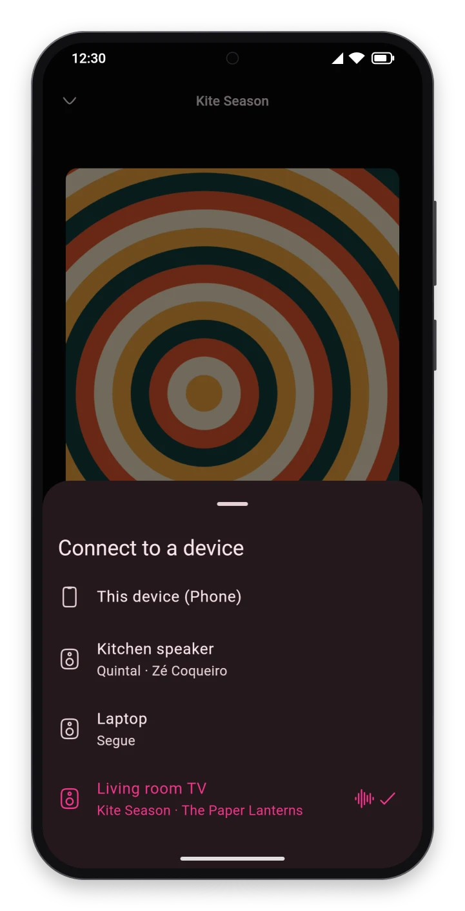

<p align="center"></p>

# Segue app

A music player for Navidrome, any other OpenSubsonic server, or Jellyfin, built around Segue Connect: you pick a
device, and whatever you play goes there. One Flutter codebase for Linux, Windows, macOS, Android and iOS, in
Portuguese, English and Spanish.

Connect needs Segue's hub next to the media server ([Setting up Connect](#setting-up-connect)). Without one, the app
plays on the device it runs on.

<p align="center">
  <a href="docs/screenshots/desktop.png"></a>
  <a href="docs/screenshots/tv.png"></a>
</p>
<p align="center">
  <a href="docs/screenshots/phone.png"></a>
  <a href="docs/screenshots/devices.png"></a>
  <a href="docs/screenshots/tablet.png"></a>
</p>

> [!NOTE]
> **Vibe-coded.** The app was written by Claude (through Claude Code), with a person deciding what
> to build and trying it on real devices. Every commit says so.

**Status: early.** The app is in no store yet: the builds for Android (an APK), Linux (a tarball) and Windows (a zip)
are in the [latest release](https://github.com/segue-music/segue-app/releases/latest), and the iOS one reaches only
TestFlight's internal group. The Android build has been tried on a tablet and on an Android TV, the iOS build on an
iPhone and in a car, with CarPlay's Now Playing screen, and the Windows build on Windows 11. macOS has no package yet.

## Features

### Connect

- The app finds the hub next to the server by itself, or takes its address at sign-in, under "Advanced". The device
  picker lists the user's other devices that are online, with what they play, and picking one makes the app control
  it.
- An icon in the top bar, before the settings' button, says how Connect is: connected to the hub, connecting, offline
  (trying again), refused (this device connected again elsewhere, say), or no hub found, the app playing here alone;
  and, with the media server out of reach, that the app shows only what was downloaded.
- Picking this device again moves the music here, at the same point, in the same modes. If the device it controls
  closes, its music stays here, paused. If its queue ends there, the player goes, and the app controls this device
  again, until another queue plays there.
- When another device starts playing, music left paused here goes, so that no device is listed paused with music that
  now plays elsewhere. Opened when nothing plays anywhere, the app picks up where the music was.

### Signing in

- Only the media server's address, user and password (`https://` is added if left out). The app finds out whether
  the server speaks Subsonic (Navidrome, other OpenSubsonic servers) or Jellyfin: a Jellyfin server, or Navidrome's
  Jellyfin API at `/jellyfin`, experimental since Navidrome 0.64 and turned on with `ND_JELLYFIN_ENABLED=true`.
- Or, on an OpenSubsonic server that takes them (LMS, which takes nothing else; Navidrome from the release after
  0.64.2), an API key made there, in place of the user and password ("Sign in with an API key"): the server says whose
  it is, and it can be taken back there without changing the password. A server that takes keys alone refuses the
  password, and the sign-in asks for a key.
- The password isn't kept: the system's secure storage gets a Subsonic token, an API key, or Jellyfin's access
  token. Signing out, at the end of the settings, ends a Jellyfin server's token; Navidrome's lasts until the
  password changes, and an API key until it is taken back on the server.

### Library

- **Home**, where the app opens: the albums played last (once any has played), as small tiles in a grid, to go back to
  one at a glance; a row of mixes; then rows of the latest added, the latest released and the most played. A row's title
  opens the albums tab in that order. Dragging the home down from its top loads it again. As the app opens, the home
  shows at once what it showed the time before, covers too, kept on the device, while it loads again; its mixes are
  those picked the time before. On a phone or a tablet, its top bar has two chips: "Shuffle", which plays the whole
  library at random, and "Favorites", which opens the favorites. On a computer or a TV, "Shuffle" is in the top bar,
  over every page, and the favorites in the side rail.
- **Mixes**: 100 songs of the library at random, of a genre ("Rock") or of a decade ("1970s"), from the genres and
  decades the user plays most (before anything has played, the genres with the most albums). They are picked again each
  time the home loads, the more played the likelier. A mix plays the first songs its tile shows, and autoplay goes on
  after its last. Out of the server's reach, there are no mixes.
- **Radios**: 100 songs like a song (the song first), an album or an artist, as the server finds them (Navidrome's
  getSimilarSongs2, from its agents and the item's own songs; Jellyfin's instant mix): from a song's menu, an album's
  menu ("More options") and a button on an artist's page. Autoplay goes on after the last, on the device that plays
  them.
- **Public links**: "Share", in a song's, an album's and a playlist's menu and beside an artist's heart, has the server
  make a link to them, a page of its own that plays them to anyone, with no sign-in, until it expires (on Navidrome a
  year after, unless its admin sets another time, or turns links off). On a phone or a tablet the link goes to the
  system's share sheet, on a computer to the clipboard, and on a TV it shows as a QR code for a phone to open. The
  server makes it with its own address: Navidrome's is the one the app reached it at, unless its admin sets
  `ShareURL`, so a link with an address of the local network opens only there, which the app says before it goes.
  Navidrome's web page lists the links, to take one back. Jellyfin has none.
- **Albums**: by name, latest released, most played, played last or latest added. Wherever albums are listed, the
  album's artist opens their page, and on a computer a button on the cover plays the album. By name, they have their
  letters beside them, which scroll to where each starts: a letter pressed, or a finger slid along them, as in a
  phone's contacts.
- **Artists**: by name or most played; by name, with their letters beside them too.
- **Genres**: by name, under the ten the user listens to most. A genre's page has a button that plays its mix, a
  row of its most played albums, and its albums by name.
- **Playlists**: the user's and those shared with them, each with its picture and how many songs it has. A
  playlist's page is laid out as an album's.
- **Search**: artists, albums and songs.
- On a Subsonic server, which counts no plays by artist or genre, those come from the most played albums. On a
  Jellyfin server, which counts plays only by song, an album's, an artist's or a genre's plays are its songs', added
  up.

### Album and artist pages

- **Album**: its cover (which opens full screen), what kind of release it is (album, EP, single, compilation), its
  artist, year, songs (numbered as their tags have them, under each disc's number and title where it has several) and
  how long they last, and at the end its release date, its record labels and a row of the artist's other albums ("More
  by Aerosmith"). Where the server doesn't say the date, the labels or the kind, MusicBrainz fills them in: by the
  album's MusicBrainz id, or, for the date and the kind only, by its name, artist and year.
- **Credits**, from a button on the album's page (on a phone or a tablet, from its menu): who performed it (with what
  they played or sang), wrote it and produced it, one a line, with the songs where it isn't all of them ("lead vocals,
  harmonica (track 2)"). The server's credits (OpenSubsonic's contributors, which Navidrome reads from the tags;
  Jellyfin's people), or, where it has none, MusicBrainz's. MusicBrainz also says where the album was recorded, mixed
  and mastered, and who made its cover and booklet, which the media servers never say.
- **Artist**: their picture, their genres, their albums (or, picked above them, their singles and EPs), five of their
  songs (the ones the user plays most, or the popular ones, which a Subsonic server learns from Last.fm) and a row of
  the library's artists like them. Where the server has no picture (Navidrome since 0.64), the one fanart.tv's users
  like most, by the artist's MusicBrainz id.
- **Biography**, from a button on the artist's page, where the server has one (Navidrome's comes from Last.fm): a
  gallery of pictures (the server's and up to three from fanart.tv), and from MusicBrainz a band's years together
  ("since 1991") and members, and where the artist comes from ("Boston, United States"), a link to a map (not on a TV).
- In the player, a song's title opens its album, and each of its artists their page. In an album's or a playlist's
  songs the artists link too, but not on a phone, where a finger on the song would often land on them.

### Playback

- **Player**: a bar that stays from page to page, and a full-screen player that the song in the bar opens. Seek,
  shuffle, repeat (the queue, or the track). A swipe on the cover (with a mouse, a drag) goes to the next or the
  previous song, and on a phone a drag down closes the player.
- **Volume**, on a computer, at the end of the bar: a button that mutes and gives the volume back, over which an
  upright slider opens as the pointer comes to it (or the keyboard's focus, whose up and down arrows move it). The
  mouse's wheel moves it over either. It is the volume of whichever device the app controls; this device's own the next
  launch keeps. A phone's and a TV's own buttons set the system's volume.
- **Lyrics**, beside the cover in the full-screen player (under it on a phone or a tablet, in its place turned), and
  full screen: the server's (OpenSubsonic's songLyrics, as Navidrome's from the tags or a `.lrc`; Jellyfin's), or else
  LRCLIB's (lrclib.net). Synced ones mark the line that plays, and a line tapped goes there. Full screen, on a phone or
  a tablet, they keep the screen on. On a TV the full-screen player opens with them, as karaoke: in three fifths of the
  screen, the line that plays bigger, growing as it comes, in the middle, those to come faint and those gone by fainter,
  the screen on while they show. A song without lyrics shows the cover alone there, and they come back with one that has
  some.
- **Queue** of whichever device the app controls: a tap plays a track there, a drag moves it, and its menu takes it
  out (but the current one). Shuffled, a move changes the play order alone. A change the device refuses goes back,
  and a message says why.
- **Play next and add to queue**: a song, an album or a playlist, on whichever device the app controls. To an empty
  queue, they are the queue, paused at the first.
- The current song stands out in lists (an album's, a playlist's, search), with an equalizer in place of its number.
- A song the media server fails to give stops the player on it, paused, and says so, rather than the player skipping
  through the queue. Play tries it again.
- **Autoplay**: as the queue's last song starts, repeat off, songs like it go after it (on a Subsonic server,
  getSimilarSongs2; on Jellyfin, its instant mix). On until a switch turns it off, in the settings or after the
  queue's last song, which takes out the songs it added that haven't played.
- **Gapless**: each song right after the one before, as a live album plays. Not while crossfading.
- **Crossfade**, off until the settings pick 2 to 12 seconds: the next song gets louder as the one before gets
  quieter, at equal power.
- **Volume normalization** (ReplayGain): off, automatic (by album where a song plays among its album's in their
  order, by song otherwise), by song or by album. The gains are the server's (OpenSubsonic's replayGain; Jellyfin's
  normalization gain), or else the file's tags. The songs play 8 dB over ReplayGain's reference (about -10 LUFS), since
  at the reference most songs of today play 6 to 10 dB quieter than as they are, and never louder than their peak lets
  them.
- **Equalizer** of ten bands, from 31 Hz to 16 kHz: presets for kinds of music, or the user's own, each band 12 dB up
  or down. The whole goes down by as much as the bands raise, so that a song never clips.
- **Quality**: the files as they are; automatic, on a device with mobile data (as they are on Wi-Fi or a cable, 160
  kbps on mobile data); or 320, 160 or 96 kbps, transcoded by the server. A change holds from the next song. A song a
  Subsonic server transcodes seeks where the server has OpenSubsonic's transcodeOffset (Navidrome has it); Jellyfin
  sends it as HLS, which seeks.
- **Sleep timer**, while the music plays on this device: it pauses it after 5, 15, 30 or 45 minutes or an hour, or as
  the song ends, the music fading out over the last 30 seconds.
- **Plays** count toward the user's most played: on a Subsonic server once a song has played half or four minutes
  (not a song of 30 seconds or less), on a Jellyfin server by the hub.

Autoplay, the crossfade, the sleep timer, the normalization and the equalizer are each device's own: a device the app
controls plays as it has them, and the settings here change this device's alone.

### Playlists and favorites

- **Playlists**: a new one from a button over the list of them; a song, an album or the song that plays added to one;
  on its page, a song taken out or moved by dragging it, and the playlist renamed or deleted. Another user's playlist,
  or a smart one, can only be played next or added to the queue.
- A song's menu is the button after its duration, the menu key or Shift+F10, a right click, or OK held on a TV's
  remote.
- **Favorites**: a heart on a song, an album or an artist (Subsonic's star, Jellyfin's favorite). They have a page of
  their own ("Favorites", first among the playlists, in the side rail, and on a phone a chip on the home): the songs, a
  line that plays them or opens them as a playlist, then a row of the albums and one of the artists. A row's title opens
  the albums or artists tab with its "Favorites" chip, which shows them alone. On a Subsonic server the latest come
  first; on Jellyfin, which doesn't say when, by name.
- Each change shows at once and goes to the server as it's made. One the server refuses goes back, and says so.

### Downloads and offline

- An album or a playlist downloads from the button beside its play button, which shows how far it has got, and
  pressed again takes it off the device, once asked. The songs come as their files are, or in the quality the
  settings pick for downloads, with their covers, lyrics and artists' pictures.
- On a device with mobile data, downloads go over Wi-Fi or a cable alone, unless the settings let them go over mobile
  data too. What failed comes again as the server is back, or from the button.
- The library's "Downloaded" chip shows the downloaded albums, and the playlists' "Downloaded" chip the downloaded
  playlists. The settings list the downloads, with the room they take.
- With the server out of reach, the top bar says so and the app shows what was downloaded: the home, the library,
  search and their pages, which play from the files. The plays made meanwhile count as the server is back, at the
  time they were made.
- Navidrome 0.64 gave its songs, albums and playlists new ids: the downloads made before take them as the server
  answers, their files kept rather than downloaded again, and what the app kept from before (the plays made out of
  reach, the home's last albums and mixes, the last playback the hub kept) finds its songs all the same.

### Devices

- **Computer**: the top bar, the side rail (albums, artists, genres, playlists, favorites) and the player bar stay, and
  pages open between them. Arrows beside the app's icon, and the keyboard's left and right, go back and forward through
  them, as a browser's do. `/` goes to the search bar, Esc takes the focus off what has it, and space plays or pauses
  (not while typing). A section's button in the side rail, picked again, takes it back to its start. The window opens
  maximized and gets no narrower than 960.
- **Phone and tablet**: the player bar and a bar with the home, the search and the library stay at the bottom, and a
  swipe goes from section to section; the home or the library picked again there goes back to its start. Pages open
  over the rest, and a swipe to the right from anywhere goes back. On a tablet, or a phone turned, the two bars float
  side by side over the page, one bar's height at the bottom; on a tablet too narrow for that, they sit in the middle,
  no wider than on a big phone. The queue has them too, a section picked there closing it and the player. Turned, the
  full-screen player has the cover beside the song and its controls, the lyrics coming in in the cover's place, and a
  drag down from anywhere closes it.
- **Sign-in on a TV with a phone**: the TV's sign-in shows a QR code, which the app on a phone signed in reads
  (Settings, "Sign in on a TV"), signing the TV in with no typing on the remote. Over the local network, sealed with a
  key the code carries (AES-GCM): on Subsonic the phone's credentials; on Jellyfin the TV signs in by Quick Connect,
  which the phone authorizes, and gets a sign-in of its own (Navidrome's Jellyfin API has Quick Connect too, since
  0.64.1, but it hasn't been tried there). The phone sends it only to an address on the local network, after naming the
  TV and its address, which the TV shows under the code; the TV's answer is sealed too, and a code is good for one
  sign-in, the TV showing another after.
- **TV**: the remote drives the app, a white ring showing where it is, and an album, an artist or a mix it is on a
  little bigger. The text is a bit bigger than on a phone, and everything keeps out of the screen's edges, which some
  TVs cut off, but for the rows of albums, which run on to the side as they scroll, as Google TV's do. No player bar
  under the pages: the side rail's first button, while something plays, opens the full-screen player, as a video player:
  the controls showing as a key is pressed and going after a few seconds, back hiding them first, on the color of the
  cover. The screen stays on while the music plays. Left alone for three minutes while the TV plays, the app opens the
  full-screen player by itself, as a screen saver would come, the screen staying on; with the controls hidden, what it
  shows moves slowly about, a few pixels in minutes, for an OLED screen not to keep a mark of it. The keyboard opens on
  the search bar with the center button, and with it open the remote's microphone, held, types what is said. OK held
  opens a menu, and a song of the queue or of a playlist moves by the remote ("Move" in its menu, then the arrows and
  OK). The remote's play/pause, next and previous buttons drive playback. Through a long list, its channel buttons go a
  page down or up, and back, far down a list, goes back to its top before it leaves the page. Google TV's Assistant
  doesn't reach the app: music asked for by name ("play Aerosmith on Segue" too) it plays on YouTube, and away from the
  keyboard the microphone is its own.
- **The system's media controls** show and command what the player bar shows, the device it follows included: on
  Linux (MPRIS) the media keys, the desktop's player widget and KDE Connect; on iOS the lock screen, Control Center,
  the headphones' buttons and CarPlay's Now Playing; on Android the notification, the lock screen and the
  headphones' buttons, whose play opens the app if the system has closed it.
- **Android** plays in the background and with the screen off. Swiped out of the recent apps, the app closes as a
  window does on a computer: this device's music pauses, and another device's plays on. Playing pauses another app's
  music, and another app playing pauses this one.
- **Android Auto**: the home (mixes and albums), the playlists, the albums and the artists, with their radios first,
  search, and what is said ("Hey Google, play Aerosmith on Segue"). What the car plays, it plays on the phone, and a
  device the app was controlling stops. Android's media controls offer the last song to resume.
- **iOS** plays in the background and with the silent switch on.
- On iOS and Android, a call pauses the music, which plays again after it, and leaving the car or unplugging the
  headphones pauses it.
- **Language**: the system's, where the app has it (English otherwise), until the settings, or before signing in a
  menu in the sign-in's corner, pick one.
- **Theme**: light, dark or the system's, in the icon's colors. The settings pick the pink, the wine or the neutral,
  and a high contrast for any of them (Material's text and outlines at 7:1 at least).
- **Licenses**: the settings list the open source licenses, those of libmpv, FFmpeg and Mbed TLS included where the
  app brings them (Android, iOS, macOS, Windows).

### Not yet

- Turning another device's autoplay on or off, or setting its sleep timer.
- The media controls on macOS and Windows.
- On a Jellyfin server: counting plays without the hub; the cover of a song that came from another device, when its
  file has none (Jellyfin doesn't fall back to the album's); and an artist's popular songs (Jellyfin knows only its
  users' plays).
- Sending the music to speakers and TVs that don't run the app (Google Cast, UPnP/DLNA).
- CarPlay as an app of its own, browsing the library on the car's screen, which needs Apple's CarPlay entitlement and
  native code.

## Running on Linux

`segue-linux-x64.tar.gz`, from the [latest release](https://github.com/segue-music/segue-app/releases/latest), runs on a
computer with glibc 2.38 or newer, GTK 3, libsecret and libmpv, all runtime packages. On Fedora:

```sh
sudo dnf install gtk3 libsecret mpv-libs
tar xzf segue-linux-x64.tar.gz
segue/segue
```

`segue/install-desktop-entry.sh` puts Segue in the application menu, with its icon: it writes
`~/.local/share/applications/io.github.mateusguilherme.segue.desktop`, pointing at the folder (run it again after
moving the folder). On Wayland the window takes its icon from that file, so without it the window has a generic one.

## Running on Windows

`segue-windows-x64.zip`, from the [latest release](https://github.com/segue-music/segue-app/releases/latest), needs only
64-bit Windows 10 or 11: the zip carries Visual C++'s runtime beside the app. Unzip it anywhere and open
`segue\segue.exe`. The app isn't signed, so Windows may stop it the first time when the zip came from the internet:
"More info", then "Run anyway".

## Running on Android and Android TV

`segue-android.apk`, from the [latest release](https://github.com/segue-music/segue-app/releases/latest), is one APK for
every processor. On a phone or a tablet, open it there, from the browser's downloads or the files app; Android first
asks to let that app install apps ("Allow from this source"). An APK signed with another key than the installed app's
doesn't install over it: the app has to be uninstalled first, its sign-in and downloads with it. The device has to reach
the media server (and the hub) at the address used to sign in.

From a computer, adb (`android-tools` on Fedora) installs it too, and it is the way onto a TV. On a phone or a tablet,
turn on wireless debugging (Settings > About: press "Build number" seven times, then Developer options > Wireless
debugging). Its main screen shows the address and port for `adb connect`; "Pair device with pairing code" shows another
port, and the code, for `adb pair`, once per computer:

```sh
adb pair <address>:<pairing port> <code>
adb connect <address>:<port>
adb install -r segue-android.apk
```

The port changes each time wireless debugging is turned on, and the address can change too when the device rejoins the
network.

On an Android TV, turn on the developer options (Settings > Device Preferences > About: press "Build" seven times)
and, in them, network debugging; then `adb connect <TV address>` and `adb install`. Newer Google TVs offer wireless
debugging instead, paired as a phone is.

Android Auto lists an app installed by hand only from "unknown sources": in the Android Auto app's settings, tap
"Version" ten times for its developer settings, and there check "Unknown sources".

## Running on iOS

The iOS version reaches iPhones through TestFlight, for now only its internal group (the testers of the App Store
Connect account), each build for 90 days. It is built on Codemagic ([docs/building.md](docs/building.md#ios)). The first
time the app reaches a server in the local network, iOS asks for permission.

What iOS does differently:
- In the background, iOS keeps the app running only while it plays. Paused, or just controlling another device, it is
  suspended after a while, and the other devices list it offline until it is opened again.
- In a car, the music shows in CarPlay's Now Playing screen, with its controls, but the app has no screen of its own
  there.
- Other devices see this one as "iPhone" (or "iPad"), not by its name in Settings (General > About > Name): since iOS
  16 an app reads that name only with an entitlement Apple grants on request
  (`com.apple.developer.device-information.user-assigned-device-name`), which the app doesn't have yet.

## Setting up Connect

Connect needs Segue's hub, which runs next to the media server: its
[README](https://github.com/segue-music/segue#running-the-hub) says how. Published at `/connect` on the media server's
address, the hub is found by itself, with nothing to type at sign-in; anywhere else, its address goes at sign-in, under
"Advanced".

To try Connect without changing the server, run a hub on your computer, pointing at the media server:

```sh
docker run --rm -p 127.0.0.1:8480:8480 -e SEGUE_MEDIA_SERVER_URL=https://navidrome.example ghcr.io/segue-music/segue-hub
```

and at sign-in, under "Advanced", put `http://127.0.0.1:8480` as the hub's address.

To see two devices on one computer, start a second copy of the app as another device:

```sh
env SEGUE_DEVICE_ID=second SEGUE_DEVICE_NAME="Second copy" segue/segue
```

## Logs

The app writes down what goes wrong, a release build too, in `segue.log`: what it couldn't do, mpv's warnings and
errors, the errors no code caught, and around them what says why: the build and the system, as it opens; which media
server it speaks to; the server going out of reach and coming back; the hub's connection coming and going; and a Connect
command that failed, here or on another device. Each line goes in as it comes, at its time with its offset from UTC.
Past 1 MB the file becomes `segue.1.log` and a new one starts, so the two hold the latest. Neither has a password, token
or API key: the addresses and requests that carry one are written without it.

The settings, under "About", take the log out of the app: on a phone or a tablet, "Share the log" sends both as one file
through the system's share sheet (an e-mail, a chat, the files), named for the device and the time; on a computer, "Open
the log's folder" opens the `logs` folder where they are:

- Linux: `~/.local/share/io.github.mateusguilherme.segue/logs/`
- Windows: `%APPDATA%\io.github.mateusguilherme\Segue\logs\`
- Android: `/sdcard/Android/data/io.github.mateusguilherme.segue/files/logs/`, which `adb pull` takes. A TV's
  settings have no line for the log, its share sheet having nowhere to send it: `adb pull` is the way there.
- iOS: the app's Application Support.

## Building

Building the app, its packages and its releases, and working on it (its tests, the README's pictures, where its code
is), are in [docs/building.md](docs/building.md).

## License

MIT, see [LICENSE](LICENSE).
